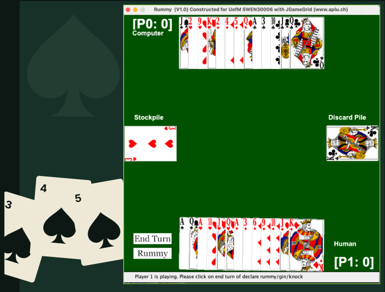
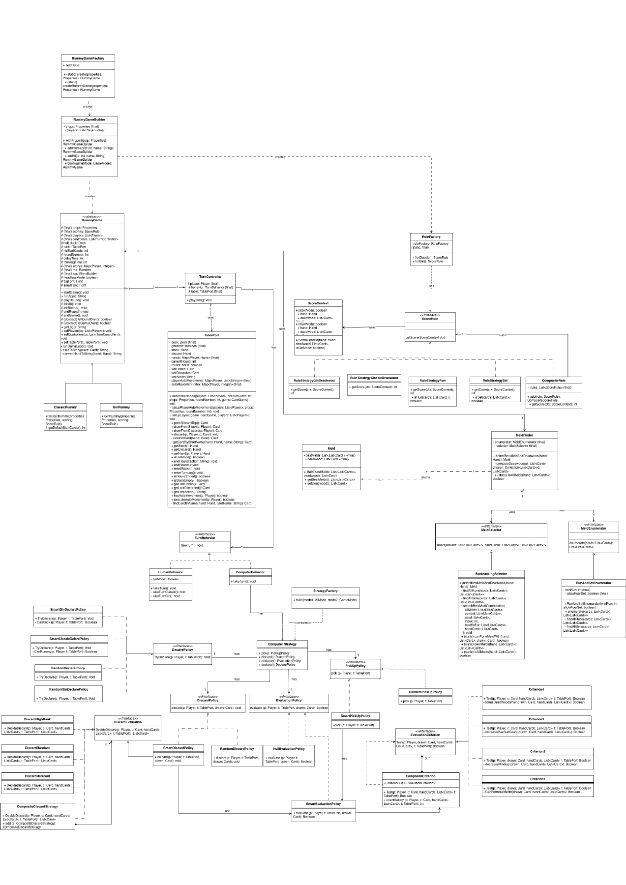
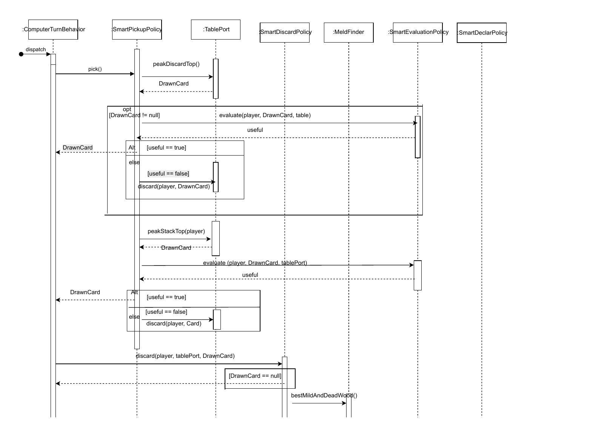
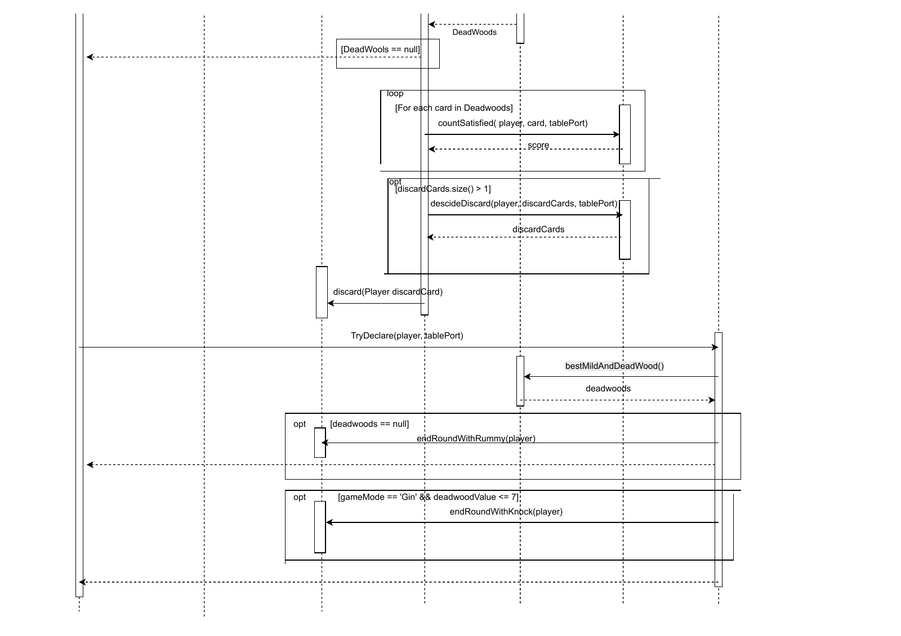

# RummyGame

A Java card game project for **Software Modelling and Design (SWEN30006), Project 2**, at the University of Melbourne, Semester 2, 2025. The project extends a supplied Rummy application with Classic and Gin variants, rule-based computer decisions, and an extensible object-oriented design.

## Project Background

The assignment places the team in the role of software engineers contracted by **CardCraft Studio**, a fictional Melbourne company entering the digital card-game market. Its initial Rummy implementation is incomplete. The task is to complete the required game behaviour while improving the design so that future game variants and computer strategies can be added more easily.

The focus is software modelling and design: separating responsibilities, applying GoF design patterns, justifying decisions through GRASP principles, and documenting both system structure and object interactions.

## Gameplay

Two players use a standard **52-card deck without jokers**. Players form **melds** and minimise **deadwood**, the cards left outside their selected melds.

- **Run:** at least three consecutive cards of the same suit, such as A–2–3 of hearts.
- **Set:** three or four cards of the same rank, such as three eights of different suits.
- **Card values:** ace = 1; 2–10 = face value; jack, queen and king = 10. Aces are low.

A turn consists of drawing a card, deciding whether to retain it, discarding a card, and declaring the end of the turn or round. The first turn starts by drawing from the stockpile; subsequent turns can use the top discard or draw from the stockpile. Rounds accumulate points until a player reaches the target score, such as 100.

### Classic Rummy and Gin Rummy

The following rules summarise the **assignment's variants**.

| Rule | Classic Rummy | Gin Rummy |
| --- | --- | --- |
| Initial hand | 13 cards per player | 10 cards per player |
| Complete-hand declaration | Declare **Rummy** when all 13 cards form valid melds | Declare **Gin** when all 10 cards form valid melds |
| Other round endings | Stockpile exhaustion | **Knock**, or stockpile exhaustion |
| Declaration scoring | Declarer earns the opponent's deadwood total | Gin declarer earns the opponent's deadwood total |
| Stockpile exhaustion | Lower-deadwood player wins the opponent's deadwood total; a tie awards no points | Same as Classic |
| Knock scoring | Not applicable | Lower-deadwood player earns the difference between the two deadwood totals; a tie awards no points |

The system checks Rummy and Gin declarations before ending the round. Under the specification, calling Knock proceeds directly to scoring; the smart computer's own Knock threshold is **7 deadwood points or fewer**.

### Meld Selection

At scoring time, the system must choose non-overlapping melds that cover the **maximum number of cards**. Each card can appear in only one selected meld. If multiple selections cover the same number of cards, choose the one with the lowest deadwood value; resolve any remaining tie randomly.

### Smart Computer Player

The specification defines four criteria for deciding whether a card is useful:

1. It immediately forms a meld with cards in the hand.
2. It reduces the minimum rank gap within its suit, or joins the only existing card of that suit.
3. It increases the maximum number of cards held in a single suit.
4. It increases the number of same-rank cards in the deadwood, improving the chance of a future set.

The computer first evaluates the top discard. If it is not useful, it draws from the stockpile and evaluates that card. A card satisfying at least one criterion is kept; an unsuitable stockpile card is discarded.

When choosing a discard from the enlarged hand, the computer identifies deadwood and selects the card satisfying the fewest criteria. Ties are resolved by the least frequent suit, then the highest card value, and finally random selection. It then declares Rummy or Gin if the hand is fully melded, Knocks in Gin when deadwood is at most 7, or ends its turn.

## Project Requirements Summary

| Area | Required outcome |
| --- | --- |
| Classic Rummy | Complete meld detection, valid Rummy declarations, round scoring and game completion |
| Gin Rummy | Add a configurable 10-card variant with Gin and Knock actions and the specified scoring rules |
| Smart opponent | Implement the four evaluation criteria, pickup/discard decisions and declaration logic |
| Extensible design | Separate changing rules and strategies from shared game flow to support future variants |
| Design justification | Explain GoF patterns, justify decisions with GRASP principles, and discuss a plausible alternative pattern for each feature |
| Structural model | Supply a design class diagram showing the added components and their relationships to the existing system |
| Behavioural model | Supply a design sequence diagram focused on evaluating a stockpile card and deciding whether to keep or discard it |
| Compatibility and testing | Preserve the supplied Gradle structure, Driver entry point, resource names, configuration behaviour and expected log format; support automated and manual testing |

## Design and Documentation

The following models and report are the project's submitted design artefacts. The report describes the design decisions, trade-offs and limitations behind the implementation.

### Design Class Model

[Open the full design class model (PDF)](documents%20/SWEM30006_Project2_designModel.png.pdf)

The model shows game creation, turn control, table operations, meld discovery, scoring and AI policies. It illustrates how shared interfaces allow game variants and decision strategies to be composed.

### Design Sequence Model

[Open the full sequence model (PDF, two pages)](documents%20/SWEN30006_Porject2_SSD.pdf)

The sequence model traces the computer turn through pickup, card evaluation, discard selection and declaration. It includes the required stockpile-card keep/discard decision and continues into the subsequent turn actions.

View both pages of the sequence model

### Design Report

[Read the full project report (PDF)](documents%20/SWEN30006_Project2_Report.pdf)

The report explains the refactoring of tightly coupled round logic into smaller components:

- **Factory and Builder:** select the game variant and assemble its dependencies.
- **TablePort and turn behaviours:** isolate table operations and organise human/computer turns.
- **MeldFinder:** separate candidate enumeration and selection from scoring.
- **Strategy and Composite:** organise scoring rules and interchangeable AI evaluation, pickup, discard and declaration policies.
- **Template Method:** structure shared turn behaviour while allowing individual decisions to vary.

The rationale emphasises low coupling, high cohesion, polymorphism, indirection and protected variations. The report also notes that game creation is not fully unified across automatic and manual modes, and that adding more evaluation strategies could increase class and dependency complexity.

## Technology and Repository Structure

The project uses **Java 21**, **Gradle**, **JGameGrid** and **JUnit 4**.

| Location | Contents |
| --- | --- |
| `app/src/main/java/rummy/` | Game logic, AI, meld selection, scoring and turn control |
| `app/src/main/resources/` | Configuration properties and card/UI assets |
| `app/src/test/` | Tests, test configurations and sample logs |
| `app/lib/` | Bundled JGameGrid library |
| `documents /` | Original design model, sequence model and report PDFs |
| `docs/images/` | README previews rendered from the original diagrams |

## Specification Reference

The background, gameplay rules and requirements above are summarised from **Project 2: Specification for Rummy — Software Modelling and Design (SWEN30006, 2025 Semester 2)**: background and gameplay on pages 1–5, smart computer behaviour on pages 5–8, and design, deliverables and testing on pages 8–11.

[Course specification on Canvas (course access required)](https://canvas.lms.unimelb.edu.au/courses/213820/pages/project-2-specification-for-rummy)
